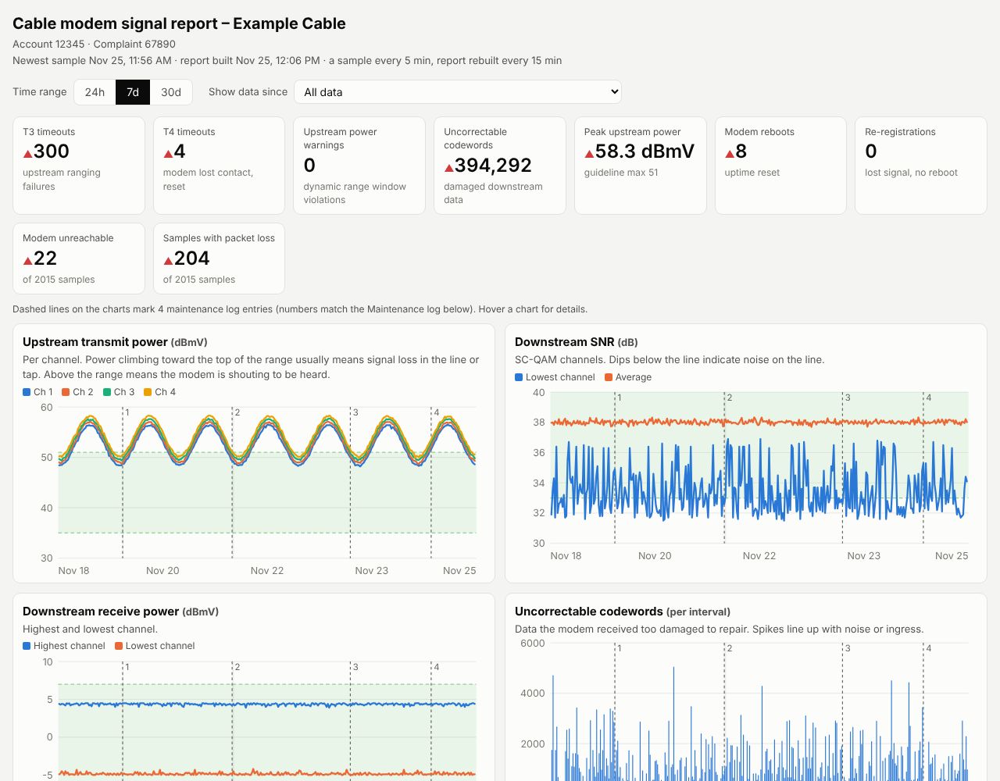

# luci-app-modem-monitor

An OpenWrt package that keeps a timestamped record of your cable modem's health, so you can show your ISP, or a regulator, what is actually happening on the line.

Every 5 minutes the router reads the modem's signal levels, error counters and event log, pings the internet, and checks the Ethernet link to the modem. LuCI shows the results as a report with charts, a daily summary, incidents and the modem log. A maintenance log marks technician visits, ISP calls, reboots and router changes on every chart, and the report can show only the data recorded after any of them.



## Features

- **Signal history:** downstream power and SNR, upstream transmit power per channel, and corrected and uncorrectable codewords.
- **Modem event log:** collected before the modem overwrites it (the S33 keeps only 100 entries). T3/T4 timeouts, DHCP/registration failures and upstream power (DRW) warnings are counted per day.
- **Reboot vs. re-registration:** a reboot is detected when the modem's uptime resets. Counters resetting while uptime keeps counting means the modem lost signal and re-registered without rebooting.
- **Maintenance log:** add entries on its own LuCI tab or from the shell. Each entry becomes a numbered marker on every chart, with a 24-hour before/after comparison. Modem reboots, loss of signal, level shifts of 1.5 dB or more, and router reboots are suggested automatically for you to confirm.
- **"Show data since" filter:** counts, charts and tables start after a chosen maintenance entry, so you can see whether a repair actually helped.
- **Reboot modem button:** sends the same command as the modem's Configuration page and logs it with the exact time.
- **Router–modem link:** CRC, alignment and collision counters, link drops and speed changes on the WAN port, so a bad patch cable can be ruled out. NIC receive overruns (`rx_missed`) are tracked separately as a router tuning issue.
- **Download all data:** one `.zip` with every CSV, the report and a diagnostics snapshot. MAC addresses and public IP addresses are masked by default.
- **Updates:** checks GitHub for a newer release daily and offers to install it from the Signal Report page. The download is verified against GitHub's published SHA-256 checksum, and nothing is installed without your click.
- **`latest.json`:** the newest sample, for Zabbix or other monitoring.

## Requirements

| | Tested | Notes |
| --- | --- | --- |
| Modem | Arris SURFboard S33 (hardware 1.0, firmware TB01.03.001.11) | Uses the HNAP JSON API behind the S33 web UI, with HTTPS/HTTP and HMAC-SHA256/MD5 auto-detected. Other Arris/CommScope SURFboard models with the same web UI may work but are untested; please open an issue with `modem-monitor test --raw` output. |
| OpenWrt | 25.12 (apk) | The `.apk` release targets OpenWrt 25.x. For 24.10 or older (opkg), build an `.ipk` with the SDK and the included `Makefile`. |
| Packages | `python3`, `luci-base`, `rpcd-mod-file`, `ca-bundle` | `python3` needs about 15–20 MB. |
| Storage | — | About 2–4 MB of CSV per month. Use USB/SSD storage on routers with small flash. |

## Install

Download the latest `.apk` from [Releases](https://github.com/RyanBlakeIT/luci-app-modem-monitor/releases), then:

```sh
scp -O luci-app-modem-monitor-1.1.4-r1.apk root@192.168.1.1:/tmp/
ssh root@192.168.1.1
apk update
apk add --allow-untrusted /tmp/luci-app-modem-monitor-1.1.4-r1.apk
```

The package is not signed by OpenWrt, so `--allow-untrusted` is needed.

Then, in LuCI, go to **Status → Cable Modem → Settings**:

1. Enter the modem password. On the S33 it is usually the last 8 characters of the serial number, unless you changed it.
2. Optionally enter your **ISP name** and a **report note** (for example an account or complaint number).
3. Check the **data directory**. On first install it's chosen automatically: a persistent, writable mount with at least 512 MB free (`/data`, then `/mnt/*`, `/srv/*`, `/opt/*`, with RAM disks ignored), otherwise `/root/modem-monitor`. History is kept for 400 days with 1 GB or more free, 180 days with 256 MB or more, and 90 days otherwise. The choice is logged (`logread -e modem-monitor`), and an existing setting or existing data is never changed.
4. Click **Save & Apply**, then **Test connection**.

## Settings

Everything is in UCI (`/etc/config/modem_monitor`) and on the Settings page. To apply your own values in one go, see `examples/settings-example.sh`.

| Option | Default | What it does |
| --- | --- | --- |
| `update_check` | `1` | Check GitHub for a newer release once a day |
| `update_repo` | `RyanBlakeIT/luci-app-modem-monitor` | Repository to check (change for forks) |
| `isp_name` | *(empty)* | Shown in the report title and text; empty = "your ISP" |
| `report_title` | *(empty)* | Replaces "Cable modem signal report" |
| `report_note` | *(empty)* | One line under the title, e.g. account / complaint reference |
| `host`, `username`, `password` | `192.168.100.1`, `admin`, — | Modem web UI login |
| `interval` | `300` | Seconds between samples |
| `report_interval` | `900` | Seconds between report rebuilds |
| `data_dir` | auto (see Install) | CSV history (persistent storage) |
| `retention_days` | auto: 400 / 180 / 90 | History older than this is deleted |
| `wan_device` | *(auto)* | Modem-facing port; auto = device of the `wan` interface |
| `modem_route` | `host` | How the router reaches the modem: `host` route, `alias` address, or `off` |
| `modem_alias_ip` | `192.168.100.10` | Address used in `alias` mode |
| `modem_eee`, `modem_led` | `0`, `1` | Fallback EEE/LED values re-sent with a reboot command (read live from the modem first) |
| `ping_targets`, `ping_count` | `1.1.1.1 8.8.8.8`, `5` | Internet reachability check |
| `us_power_min/max`, `ds_power_min/max`, `ds_snr_min` | `35/51`, `-7/7`, `33` | Shaded "healthy" bands (common DOCSIS 3.1 guidelines, not ISP specs) |

### Reaching the modem (and DDNS)

The router must reach the modem's management address (192.168.100.1). The default `host` mode adds a `/32` route over the WAN device and no extra address, and requests come from your WAN IP. `alias` mode adds `192.168.100.10/24` to the WAN device instead, labelled `<dev>:mm`. A DDNS client configured with `ip_source=interface` on that device can pick up the private alias as your "public" IP, so prefer `host` mode. The diagnostics in the export flag this conflict.

## Command line

```sh
modem-monitor test [--raw]                  # log in and print what the modem returns
modem-monitor poll                          # take a sample now
modem-monitor report                        # rebuild the report
modem-monitor reboot-modem [--note "why"]   # reboot the modem and log it (10-minute guard; --force)
modem-monitor mark "note" [--type T] [--time "YYYY-MM-DD HH:MM"] [--end "YYYY-MM-DD HH:MM"]
modem-monitor maint-list [--json]
modem-monitor maint-edit ID [--type T] [--time ...] [--end ...] [--note ...]
modem-monitor maint-confirm ID | maint-del ID
modem-monitor maint-import FILE.csv         # columns: time,end_time,type,note[,source]
modem-monitor export [--full]               # one .zip; --full keeps MAC/public IP addresses
modem-monitor update-check [--json]         # is a newer release on GitHub?
modem-monitor update-install                # download (verified) and install it
modem-monitor update-status                 # progress of a running install
```

Maintenance types: `tech`, `isp-call`, `outage`, `modem-reboot`, `router-change`, `other`.

## Data and privacy

- Everything stays on the router. The only outside connections are the pings and, if update checks are on, one daily request to the GitHub API for the latest release.
- The modem password is stored in UCI in plain text, as with other OpenWrt credentials.
- The report and `latest.json` are served by uhttpd at `http://<router>/modem-monitor/` on your LAN.
- Exports mask MAC addresses and public IP addresses unless you use `--full`.

## Building

- **apk (OpenWrt 25.x):** needs apk-tools v3. Run `./build.sh`; optional variables are `APK=/path/to/apk`, `RELEASE=2`, `MAINTAINER="Name <mail>"` and `URL=https://github.com/you/repo`.
- **OpenWrt SDK / buildroot:** copy this directory into a LuCI feed (for example `feeds/luci/applications/`) and run `make package/luci-app-modem-monitor/compile`. This produces an `.ipk` or `.apk` to match the SDK. The `Makefile` is provided as a starting point and has not been tested in an SDK build.
- **Releases:** bump `VERSION` in `root/usr/bin/modem-monitor` (and `PKG_VERSION` in `Makefile`) and push to `main`. GitHub Actions lints, smoke-tests against the mock modem, builds the `.apk`, creates the `v<VERSION>` tag and publishes the release. Pushing a matching `v*` tag does the same. Notes come from `.github/release-notes/<tag>.md`, or otherwise from the matching `CHANGELOG.md` section. Every push to `main` also uploads the `.apk` as a build artifact.
- **Without a modem:** `test/mock_s33.py` emulates the S33 API; see `test/README.md`.

## Disclaimer

Not affiliated with Arris, CommScope or any ISP. The reboot button sends the same request as the modem's own web page; use it at your own risk. The healthy ranges are general guidelines, and your ISP's specifications may differ.

## License

MIT; see `LICENSE`.
